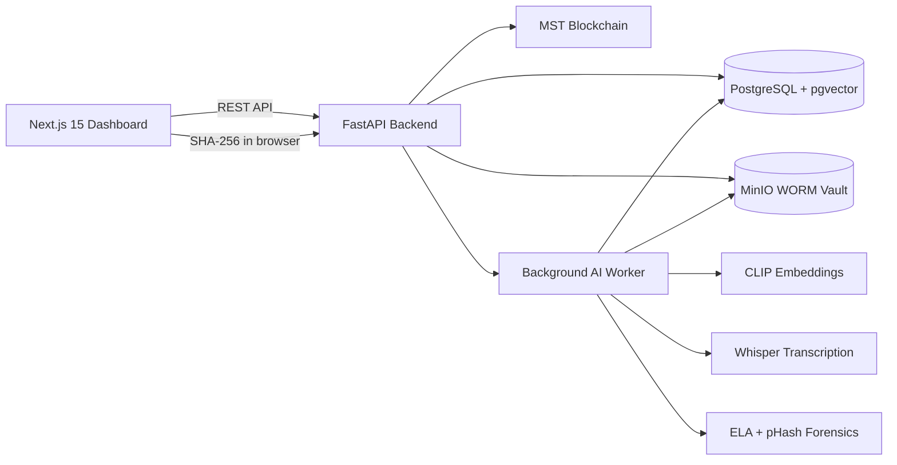

# LEXVAULT
## AI-Powered Legal Evidence Management System

LEXVAULT is a tamper-evident digital evidence management platform for ingesting, preserving, verifying, searching, analyzing, and transferring custody of legal evidence. It combines cryptographic hashing, immutable object storage, PostgreSQL metadata, pgvector semantic indexing, multimodal AI, forensic image analysis, and blockchain anchoring.

This document describes the project from the initial setup through the completed Prompts 1-6 implementation.

---

## 1. Project Goals

The system is designed to provide:

- Evidence ingestion with client-side and server-side SHA-256 verification.
- Immutable evidence storage using a MinIO WORM vault.
- PostgreSQL metadata and chain-of-custody records.
- MST Blockchain anchoring for evidence hashes and custody operations.
- Multimodal AI indexing for images, video, audio, and transcripts.
- Forensic image analysis for tamper indicators.
- Semantic search over evidence embeddings.
- Public file verification before trust decisions are made.
- Secure, time-limited evidence sharing.
- A Next.js command-center dashboard for operators.
- Automated end-to-end validation of the evidence lifecycle.

---

## 2. High-Level Architecture



### Main workflow

1. A user selects an evidence file in the browser.
2. The browser computes the SHA-256 digest with the Web Crypto API.
3. Upload metadata and the client digest are sent to FastAPI.
4. FastAPI streams the file into MinIO while calculating a server-side SHA-256 digest.
5. The client and server digests are compared.
6. Matching evidence is recorded in PostgreSQL.
7. The evidence hash is registered on-chain or through local mock-chain mode.
8. An initial custody record is inserted.
9. Heavy AI processing runs in a background thread.
10. AI results and forensic values are persisted.
11. Operators can search the evidence semantically, verify files, transfer custody, and create expiring share links.

---

## 3. Technology Stack

### Backend

- Python 3.11
- FastAPI
- Uvicorn
- Pydantic
- PostgreSQL
- pgvector
- Psycopg 3
- MinIO Python SDK
- Web3.py
- eth-account
- py-solc-x

### Frontend

- Next.js 15.5.25
- React 19.1.1
- TypeScript
- Custom responsive CSS
- Web Crypto API
- Native audio and video controls

The frontend currently uses custom CSS rather than Tailwind or shadcn/ui because those packages were not present in the original frontend project.

### AI and forensic processing

- PyTorch CPU wheels
- Transformers
- CLIP
- Pillow
- faster-whisper
- CTranslate2
- OpenCV
- imagehash
- NumPy
- FFmpeg inside the backend image

### Infrastructure

- Docker Compose
- PostgreSQL/pgvector container
- MinIO server
- MinIO client bucket initialization container
- FastAPI backend container
- Next.js frontend container

---

## 4. Repository Structure

```text
.
|-- .env
|-- .gitignore
|-- docker-compose.yml
|-- PROJECT_DOCUMENTATION.md
|-- backend/
|   |-- Dockerfile
|   |-- requirements.txt
|   |-- app/
|   |   |-- main.py
|   |   |-- api/v1/
|   |   |   |-- evidence.py
|   |   |   |-- search.py
|   |   |   |-- sharing.py
|   |   |-- services/
|   |   |   |-- ai_indexing_service.py
|   |   |   |-- forensic_service.py
|   |   |   |-- web3_service.py
|   |   |-- workers/
|   |       |-- evidence_processor.py
|   |   |-- web3_config.json
|   |-- contracts/
|   |   |-- EvidenceTracker.sol
|   |-- migrations/
|   |   |-- 001_initial_schema.sql
|   |-- scripts/
|       |-- deploy.py
|       |-- test_pipeline.py
|-- frontend/
    |-- Dockerfile
    |-- package.json
    |-- app/
    |   |-- layout.tsx
    |   |-- page.tsx
    |   |-- globals.css
    |-- components/
        |-- CustodyTimeline.tsx
        |-- EvidenceUploadModal.tsx
        |-- SemanticSearch.tsx
        |-- TelemetryBar.tsx
        |-- VerificationDropzone.tsx
```

---

## 5. Docker Services

Defined in `docker-compose.yml`:

| Service | Purpose | Port |
|---|---|---:|
| `database` | PostgreSQL with pgvector | `5432` |
| `minio` | Object storage and MinIO console | `9000`, `9001` |
| `createbuckets` | Creates and locks the evidence bucket | internal |
| `backend` | FastAPI API and AI worker runtime | `8000` |
| `frontend` | Next.js dashboard | `3000` |

### PostgreSQL

- User: `forensic_admin`
- Database: `evidence_db`
- Password is configured in Compose for local development.
- Data is persisted in the `postgres_data` Docker volume.

### MinIO

- API: `http://localhost:9000`
- Console: `http://localhost:9001`
- Bucket: `evidence-vault`
- Bucket retention: COMPLIANCE for 365 days
- Object lock enabled during bucket creation
- Data is persisted in the `minio_data` Docker volume.

### Docker volume warning

Use `docker compose down` to stop and remove containers while preserving data. Do not use `docker compose down -v` unless database and MinIO data should be deleted.

---

## 6. Environment Configuration

Docker Compose reads the project-root `.env` file:

```text
C:\Users\osmpu\Downloads\SEM5\eri new\.env
```

Required Web3 variables:

```env
WEB3_RPC_URL=https://your-mst-rpc-provider
BLOCK_EXPLORER_URL=https://coral.mstscan.com
WALLET_PRIVATE_KEY=your_private_key
CONTRACT_ADDRESS=0xYourDeployedContractAddress
```

Do not store real secret values in this documentation. Do not commit `.env` files. The repository `.gitignore` excludes `.env` and `.env.*`.

The backend uses these values for:

- MST Blockchain RPC connectivity.
- Relayer account signing.
- Contract calls and transaction submission.

If Web3 variables are absent, the application falls back to local mock behavior for supported operations. A live RPC connection alone does not replace the need for a deployed contract address.

---

## 7. Database Schema

Migration file: `backend/migrations/001_initial_schema.sql`

### `evidence`

Stores the primary evidence record:

- UUID identifier.
- Case number.
- Title and original filename.
- MIME type.
- File size.
- SHA-256 hash.
- Perceptual hash.
- MinIO object key.
- MST transaction hash.
- Block number.
- Current custodian.
- Tamper flag.
- Tamper score.
- Creation timestamp.
- `is_on_spot_capture`: Boolean indicating whether the evidence was captured live on-scene via the hardware optical shutter.
- `exif_data`: JSONB object containing camera telemetry (Make, Model, Lens, Software signatures, ISO), GPS coordinates (latitude, longitude, elevation), direct **Google Maps Satellite & Pinpoint** link (`https://www.google.com/maps?q=...`), and EXIF stripping warnings.

### `evidence_ai_index`

Stores multimodal search data:

- Evidence ID.
- Transcript text.
- `vector(512)` embedding.
- Creation timestamp.

An HNSW index uses cosine distance for semantic search.

### `custody_history`

Stores append-only custody events:

- Evidence ID.
- From custodian.
- To custodian.
- Action type.
- Notes.
- MST transaction hash.
- Timestamp.

A PostgreSQL trigger rejects updates and deletes, preserving the append-only property.

---

## 8. Smart Contract and Web3 Layer

Contract: `backend/contracts/EvidenceTracker.sol`

### Contract responsibilities

- Register an evidence hash.
- Store the initial custodian.
- Track the current custodian.
- Store registration time.
- Store the evidence storage URI.
- Transfer custody.
- Verify whether an evidence hash exists.
- Emit registration and custody events.

### Relayer model

The contract deployer is assigned as the relayer. Contract mutations are restricted with `onlyRelayer`.

### Web3 service

`backend/app/services/web3_service.py` provides wrappers for:

- Registration.
- Custody transfer.
- Chain verification.
- Blockchain status.
- Mock transactions when live configuration is unavailable.

### Deployment script

`backend/scripts/deploy.py` compiles and deploys the Solidity contract using py-solc-x and writes ABI/configuration information to `backend/app/web3_config.json`.

### MST Blockchain state

The backend connects dynamically to MST Blockchain (MST Coral Testnet 54635, MST Testnet 91562037, or MST Mainnet 4646). The status endpoint reports chain connectivity, chain ID, latest block, relayer address, balance, network_name, and explorer_url.

The live contract address must be deployed and configured before relying on real contract mutations.

---

## 9. Prompt 1: Project and Infrastructure Setup

Completed:

- Created the project structure.
- Configured Docker Compose.
- Added backend and frontend Dockerfiles.
- Started PostgreSQL, MinIO, backend, and frontend containers.
- Fixed outdated MinIO image references.
- Resolved the MinIO console port conflict.
- Added persistent Docker volumes.
- Added the bucket initialization service.
- Added local environment configuration.

Validated:

- Docker engine startup.
- Container startup.
- Backend health endpoint.
- Frontend HTTP response.
- MinIO availability.

---

## 10. Prompt 2: Smart Contract and Web3 Integration

Completed:

- Implemented `EvidenceTracker.sol`.
- Added registration and custody transfer methods.
- Added chain verification.
- Added events.
- Added Web3 service wrappers.
- Added deployment script.
- Added mock-chain behavior for local development.
- Added blockchain status endpoint.
- Connected the backend to MST Blockchain RPC configuration.

Validated:

- Mock registration.
- Mock custody transfer.
- Mock chain verification.
- MST Blockchain RPC connectivity.
- Relayer detection and status reporting.

---

## 11. Prompt 3: Evidence Ingestion, MinIO, and Hashing

Completed:

- Added multipart evidence upload.
- Added browser SHA-256 calculation.
- Added streaming server SHA-256 calculation.
- Compared client and server hashes.
- Stored accepted files in MinIO.
- Stored metadata in PostgreSQL.
- Added initial custody records.
- Added evidence verification.
- Added background processing trigger.
- Configured WORM/COMPLIANCE retention.

The upload pipeline is:

```text
Browser file
  -> Web Crypto SHA-256
  -> multipart upload
  -> MinIO streaming upload
  -> server SHA-256
  -> client/server comparison
  -> PostgreSQL metadata
  -> blockchain anchor
  -> initial custody event
  -> background AI processing
```

---

## 12. Prompt 4: Multimodal AI and Forensic Analysis

### CLIP indexing

Implemented in `ai_indexing_service.py`:

- Image embeddings.
- Text embeddings.
- 512-dimensional normalized vectors.
- Lazy model loading.
- Thread-safe model initialization.

### Whisper transcription

Implemented:

- Audio transcription.
- Video transcription.
- Word-level timestamps.
- CPU/int8 model execution.

### Video processing

Implemented:

- OpenCV frame extraction.
- Configurable frame limit.
- Frame embedding aggregation.
- First-frame forensic analysis.

### Forensic analysis

Implemented in `forensic_service.py`:

- JPEG recompression comparison.
- ELA-style difference analysis.
- High-error ratio calculation.
- Tamper score calculation.
- Perceptual hash generation.
- Tamper flag generation.

### Background worker

`evidence_processor.py`:

- Downloads the object from MinIO.
- Detects the MIME type.
- Processes images, audio, and video.
- Writes transcripts, embeddings, and forensic values to PostgreSQL.
- Runs off the FastAPI request path using a background thread.

### Runtime fixes

- Added FFmpeg to the backend image.
- Used CPU Torch installation for local environments.
- Avoided duplicate Torch installation in requirements processing.
- Loaded CLIP with safetensors-compatible behavior.
- Validated CLIP inference with a 512-length vector.
- Validated Whisper transcription.

---

## 13. Prompt 5: Next.js Dashboard

### Verification dropzone

Component: `frontend/components/VerificationDropzone.tsx`

Features:

- Drag and drop & local file picker.
- Browser-native WebCrypto SHA-256 calculation.
- Dual-layer verification: Exact SHA-256 match & 64-bit DCT perceptual hash (pHash) matching.
- **🔴 Direct Red Tamper Localization (Default Active Tab)**: Highlights exact modified pixels in semi-transparent red (`rgba(239, 68, 68, 0.55)`), draws OpenCV contour bounding boxes labeled `ALTERED`, and reports exact altered pixel percentages (`ALTERED AREA: X.XX%`) with coordinates chips.
- **↔️ 3-Way Interactive Split Slider**: Real-time slider between:
  1. `🔴 Original vs Red Tamper Highlight`
  2. `Original Vault vs Uploaded`
  3. `Uploaded vs ELA Heatmap`
- **👥 Side-by-Side Dual View** and **🔬 Thermal Diff Heatmap (JET)**.
- **PDF Text Diff Viewer**: Detects added (`+`) and removed (`-`) lines via `difflib`.
- Standalone ELA & Red Anomaly Localization for unregistered files.
- Custodian, block number, and MSTScan transaction explorer links.

### Evidence table & repository

Component: `frontend/components/EvidenceTable.tsx`

Features:

- Table and grid dual-view toggle.
- Category & MIME type filters.
- Case number search filter.
- **`✕ Clear Filter` Button**: 1-click instant reset of active case or keyword filters.
- Direct row inspection launching the Evidence Inspector Drawer.

### ELA forensic viewer

Component: `frontend/components/ELAViewer.tsx`

Features:

- On-the-fly dynamic ELA generation from MinIO WORM storage.
- **Dual-Mode Inspection Toggle**:
  - `🔴 Red Anomaly Mask`: Direct anomaly overlay on original evidence with OpenCV bounding boxes labeled `ANOMALY`.
  - `🌡️ Thermal Spectrum`: Classic multi-color JET colormap.
- Interactive split slider divider.
- Quantitative tamper anomaly score & 64-bit perceptual hash.

### Semantic search

Component: `frontend/components/SemanticSearch.tsx`

Features:

- Natural-language query input.
- **1-Click Quick Suggestion Topic Chips**: Pre-populated indexed topics (`traffic accident`, `armed robbery`, `audio wiretap`, etc.).
- **Zero-Match Guidance**: Explains vector similarity thresholds and provides clickable recovery fallback chips.
- Semantic API request with similarity confidence percentage.
- Case number and title cards.
- Transcript snippets and image/audio/video preview players.
- Secure-link copy action with expiration countdown.

### Custody timeline

Component: `frontend/components/CustodyTimeline.tsx`

Features:

- Chronological custody nodes with optimized spacing and vertical connector lines.
- From/to custodian formatting.
- Action types, timestamps, and on-chain transaction hashes.
- Transfer custody dialog with notes and action selection.

### Dashboard shell

Component: `frontend/app/page.tsx`

Tabs:

1. Evidence repository and semantic search.
2. Upload new evidence.
3. Public verification dropzone.
4. System and ledger health.

### Live telemetry

Component: `frontend/components/TelemetryBar.tsx`

Uses the existing blockchain status endpoint to display live values such as:

- Network connection state.
- Chain ID.
- Latest block.
- WORM compliance label.
- Contract configuration state.

The telemetry refreshes periodically and does not hardcode blockchain values.

---

## 14. Prompt 6: Secure Sharing and End-to-End Verification

### Secure sharing endpoint

Implemented in `backend/app/api/v1/sharing.py`:

```text
GET /api/v1/evidence/{evidence_id}/share-url
```

Query parameters:

- `expiry_minutes`: 1 to 60, default 15.
- `view_mode`: `preview` or `download`.
- `override_tampered`: explicit override for tampered downloads.

Behavior:

- Looks up the evidence record.
- Rejects unknown evidence.
- Rejects download links for tampered evidence unless overridden.
- Generates a MinIO presigned GET URL.
- Uses `inline` disposition for previews.
- Uses `attachment` disposition for downloads.
- Returns expiry metadata.

### End-to-end pipeline

Script: `backend/scripts/test_pipeline.py`

Cases:

1. Uploads a synthetic authentic image.
2. Verifies object size and MinIO Object Lock configuration.
3. Waits for and validates a 512-dimensional embedding.
4. Runs semantic search and checks ranking.
5. Transfers custody through the API.
6. Checks the custody row was appended.
7. Confirms database updates/deletes are rejected.
8. Mutates one pixel.
9. Verifies the mutated upload is not authentic.
10. Confirms the tamper score is elevated.

Final observed result:

```text
Case 1 upload: OK
Case 1 object lock and embedding: OK
Case 2 semantic ranking: OK
Case 3 custody append-only behavior: OK
Case 4 mutated-image verification: OK
Prompt 6 pipeline: PASS
```

---

## 15. API Reference

### Health

```text
GET /health
```

Returns backend health status.

### Blockchain status

```text
GET /api/v1/blockchain/status
```

Returns connection state, configuration state, chain ID, latest block, and relayer information when available.

### Evidence upload

```text
POST /api/v1/evidence/upload
```

Multipart fields:

- `file`
- `case_number`
- `title`
- `client_sha256`
- `initial_custodian`

Returns:

- Evidence ID.
- SHA-256 hash.
- MinIO object key.
- MST transaction hash.
- Block number.
- Mock-chain indicator.

### Evidence verification

```text
POST /api/v1/evidence/verify
```

JSON body:

```json
{
  "sha256_hash": "64 hexadecimal characters"
}
```

Multipart file verification (`multipart/form-data` with `file`) is also supported and triggers multi-modal computer vision and text analysis.

Returns:
- `verified` (boolean): Cryptographic SHA-256 match status.
- `match_found` (boolean): Whether a perceptual hash derivative or text sequence match was identified.
- `match_type` (`exact_hash` | `phash` | `pdf_text` | `audio_video`).
- `red_overlay_b64` (string, base64 PNG): Direct red highlight mask (`rgba(239, 68, 68, 0.55)`) with labeled OpenCV bounding boxes around altered regions.
- `tamper_boxes` (array): Bounding box coordinates `[{ x, y, w, h, area }]`.
- `changed_pixels_ratio` (float): Exact proportion of altered pixels (e.g. `0.0417` = 4.17%).
- `diff_heatmap_b64` (string, base64 PNG): Thermal JET colormap difference heatmap.
- `ela_heatmap_b64` (string, base64 PNG): Error Level Analysis compression heatmap.
- `original_b64` & `uploaded_b64` (string, base64 PNG): Baseline and uploaded images.
- `text_diff` (object): Line-by-line additions and deletions for altered PDF documents.
- `on_chain` (object) & `custody_history` (array): Smart contract anchoring details.

### Forensic ELA & Red Anomaly Localization

```text
GET /api/v1/forensics/{evidence_id}/ela-heatmap
```

Fetches the image directly from MinIO and executes on-the-fly Error Level Analysis and red anomaly mask localization.

Returns:
- `original_b64`: Original image base64 PNG.
- `heatmap_b64`: JET colormap thermal compression heatmap.
- `red_overlay_b64`: Direct red highlight overlay with OpenCV `ANOMALY` bounding boxes.
- `tamper_boxes`: Bounding box perimeters array.
- `tamper_score`: Anomaly deviation score between 0.0 and 1.0.
- `phash`: 64-bit DCT perceptual hash.

### Court Dossier PDF Certificate

```text
GET /api/v1/evidence/{evidence_id}/certificate
```

Generates an official Section 65B Indian Evidence Act / BSA 2023 § 63 certified court dossier PDF with embedded QR code.

### Semantic search

```text
POST /api/v1/search/semantic
```

JSON body:

```json
{
  "query": "white sedan with broken headlight",
  "limit": 10,
  "threshold": 0.2
}
```

Returns evidence IDs, case numbers, titles, hashes, MIME types, object keys, transcripts, and similarity values.

### Custody transfer

```text
POST /api/v1/evidence/{evidence_id}/custody
```

JSON body:

```json
{
  "to_custodian": "mock-custodian",
  "action_type": "COURT_SUBMISSION",
  "notes": "Evidence submitted to court"
}
```

### Secure share URL

```text
GET /api/v1/evidence/{evidence_id}/share-url?expiry_minutes=15&view_mode=preview
```

Returns a signed URL, expiry metadata, content disposition, view mode, and tamper state.

---

## 16. Running the Project

### Start Docker Desktop

Docker Desktop must be running before the services are started.

### Start all services

```powershell
Set-Location "C:\Users\osmpu\Downloads\SEM5\eri new"
docker compose up -d
```

For dependency or Dockerfile changes:

```powershell
docker compose up -d --build
```

### Check service status

```powershell
docker compose ps
```

### Check backend health

```powershell
Invoke-RestMethod http://localhost:8000/health
```

### View frontend

```text
http://localhost:3000
```

### API documentation

```text
http://localhost:8000/docs
```

### MinIO console

```text
http://localhost:9001
```

### View backend logs

```powershell
docker compose logs -f backend
```

### Stop services while preserving data

```powershell
docker compose down
```

### Run the end-to-end pipeline

```powershell
docker compose exec -T backend python scripts/test_pipeline.py
```

---

## 17. Validation History

The following checks have passed during implementation:

- Docker Compose startup.
- Backend health endpoint.
- Frontend HTTP response.
- PostgreSQL schema availability.
- MinIO bucket creation.
- MinIO WORM/COMPLIANCE configuration.
- Evidence upload.
- Client/server SHA-256 comparison.
- Evidence verification.
- Mock blockchain registration.
- MST Blockchain RPC connection.
- CLIP image inference.
- 512-dimensional vector generation.
- Whisper transcription.
- Forensic image analysis.
- Video dependency installation.
- Semantic ranking.
- Custody transfer.
- Append-only trigger enforcement.
- Presigned share URL generation.
- Next.js production build.
- Backend Python compilation.
- Full Prompt 6 pipeline.

The frontend build completed successfully with `npm run build`. CSS builds may emit non-blocking Autoprefixer compatibility warnings about flex alignment values.

---

## 18. Security Considerations

Current protections:

- Client/server digest comparison.
- Immutable MinIO retention configuration.
- Append-only custody history trigger.
- Time-limited signed object URLs.
- Tampered download restrictions.
- Browser-side hashing before upload.
- CORS restricted to the local frontend origin.
- Private configuration excluded from Git.

Production hardening still required:

- Add authentication and role-based authorization.
- Protect custody transfer endpoints with operator permissions.
- Use HTTPS for all public and internal endpoints.
- Use a production MinIO endpoint and TLS.
- Move secrets to a proper secrets manager.
- Rotate credentials if they are ever exposed.
- Add rate limiting and audit logging.
- Add malware scanning and file-type validation.
- Add stronger access controls around share URLs.
- Avoid exposing detailed operational errors to untrusted clients.
- Deploy the real contract and verify its address before production use.

---

## 19. Known Limitations

- Local Docker mode is the primary validated environment.
- The frontend uses custom CSS rather than installed Tailwind/shadcn packages.
- Media previews require a browser-reachable MinIO endpoint.
- Search results require completed background AI indexing.
- PDF files are stored and shareable but do not receive CLIP image analysis in the current worker.
- Live MST Blockchain contract operations require a deployed and configured contract address.
- Authentication and authorization are not yet implemented.
- The Docker Compose `version` field is obsolete in modern Compose and may emit a warning.

---

## 20. Current Completion Status

### Completed

- Prompts 1 through 6.
- Local Docker infrastructure.
- Evidence upload and verification.
- PostgreSQL and pgvector storage.
- MinIO WORM vault.
- Smart contract and Web3 service layer.
- Multimodal AI processing.
- Semantic search.
- Next.js dashboard.
- Secure sharing.
- Media previews.
- Custody timeline and transfer.
- Automated end-to-end pipeline.
- Dark Digital Forensics Command Center visual refactor.

### Completed & Production Deployed

- Deployed `EvidenceTracker.sol` on **MST Mainnet** (`0x62ae3A34D97895EC7f353F0F8AC44ac4B2260c7e`, Chain ID `4646`).
- Live on-chain registration, custody transfers, and WORM retention verified on MSTScan.
- 3-Persona Role-Based Access Control (`1001` Investigator, `2002` Forensic Lab, `3003` Court Justice).
- Live cloud deployment on Render (Frontend: `https://lexv-buildathon2-0-frontend.onrender.com`, Backend: `https://lexvault-backend.onrender.com`).
- Direct client-side JSON-RPC queries to `https://mariorpc.mstblockchain.com/` for real-time mobile/desktop node telemetry.
- On-Spot Crime Scene Optical Shutter with real-time GPS geolocating and Google Maps pinpointing.
- Deep EXIF & Hardware Metadata Forensics Card with stripping warnings and software signature inspection.
- PDF Document Clause Differential Engine with forensic risk metrics.
- Section 65B Indian Evidence Act / BSA § 63 court PDF certificate generator with dynamic QR codes.

---

## 22. Production Cloud Deployment & Live Infrastructure

| Component | Target Platform | Live Endpoint / Contract |
| :--- | :--- | :--- |
| **Frontend Web App** | Render Cloud | [lexv-buildathon2-0-frontend.onrender.com](https://lexv-buildathon2-0-frontend.onrender.com) |
| **Backend REST API** | Render Cloud | [lexvault-backend.onrender.com](https://lexvault-backend.onrender.com) |
| **PostgreSQL Database** | Render Cloud (Oregon) | `evidence_db_htz2` (PostgreSQL 16) |
| **MST Smart Contract** | MST Mainnet (Chain 4646) | [`0x62ae3A34D97895EC7f353F0F8AC44ac4B2260c7e`](https://mstscan.com/address/0x62ae3A34D97895EC7f353F0F8AC44ac4B2260c7e) |
| **MST Mainnet RPC** | Public Validator | `https://mariorpc.mstblockchain.com/` |
| **MST Block Explorer** | MSTScan | [mstscan.com/address/0x62ae...](https://mstscan.com/address/0x62ae3A34D97895EC7f353F0F8AC44ac4B2260c7e) |

---

## 21. Quick Start

```powershell
Set-Location "C:\Users\osmpu\Downloads\SEM5\eri new"
docker compose up -d
Invoke-RestMethod http://localhost:8000/health
Start-Process "http://localhost:3000"
```

LEXVAULT is then available as a local digital evidence command center.
